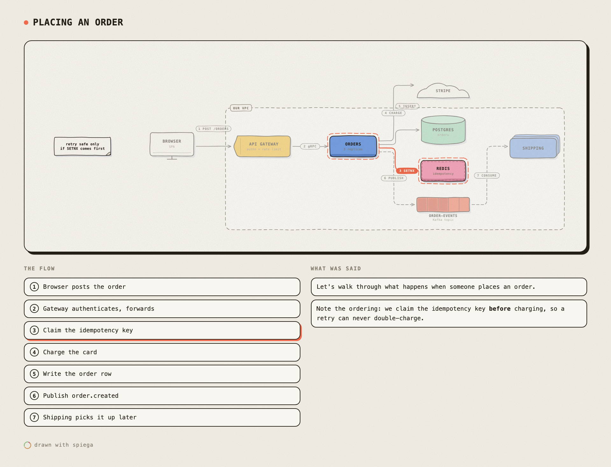

# handwave

A hand-drawn board an AI agent draws on **while it explains**.

You ask how something works. The agent answers in the terminal, as usual — and
beside it, a board fills in: boxes for the services, labelled arrows for the
calls, a dashed enclosure round the VPC, a note where the gotcha is. Then it
walks the request through, one numbered hop at a time.

It is meant for the thing a terminal is bad at: holding six nouns and the
arrows between them in your head while you read a paragraph about them.



## Why not Miro, or Mermaid

Miro is a place you go. This is a pane beside the conversation that the agent
is already having, and the board is gone when you are done unless you keep it.

Mermaid renders a finished diagram. This is drawn incrementally, in the order
the explanation goes, which is most of what makes it followable — and it looks
drawn, not generated, so it reads as somebody thinking rather than a document.

## Install

```bash
npm i -g handwave        # or: git clone … && cd handwave && npm link
```

No dependencies, no build step. Node 20+.

## Use it yourself

```bash
handwave draw '{"op":"title","text":"Placing an order"}'   # starts a board, prints its URL
handwave draw '{"op":"node","id":"gw","kind":"gateway","label":"API Gateway","sub":"authn"}'
handwave draw '{"op":"node","id":"orders","kind":"service","label":"Orders"}'
handwave draw '{"op":"edge","from":"gw","to":"orders","label":"gRPC"}'
handwave say  "The gateway does **authn** and rate limiting, then hands off."
```

Give the board a window of its own — chromeless, no tabs, its own Dock entry,
so it sits beside your terminal like a native panel:

```bash
handwave open --size 1200x900 --pos 60,60
```

Render a whole spec with no server, or keep what is on the board:

```bash
handwave render examples/order-flow.json -o order-flow.html
handwave snapshot -o docs/board.html
```

`handwave help` lists the rest.

**Replay.** A board holds the order it was drawn in, not just its final state,
so press **replay** (or `r`) and the session plays back as it happened: the
line that was said, then the thing it was about being drawn, with the camera
moving to wherever the work is and the words captioned over the picture. On
anything complex the finished board is a wall; the replay is the explanation.
It ends on a wide shot of the whole thing.

The log lives on the board, so a replay can also be asked for from outside —
`handwave replay`, or `board_replay` over MCP. An agent that has just finished
an explanation can offer to play it back without thinking the drawing out a
second time, and nothing is re-sent: it is the same session, run again.

**Keys on the board:** `←` `→` walk the flow, `space` plays it, `r` replays the
session, `+` `-` zoom a step at a time, `0` or `f` fits, `esc` stops.

**Where to put the board.** `handwave open` gives it a real window and is the
right answer for anything interactive. A terminal pane (`terminal-browser
open "$(handwave url)"`) is good for *glancing* while you work and for stepping
a flow with the arrow keys — those repaint once per keypress. It is poor at
continuous zoom and dragging, because every frame has to be encoded and pushed
through the TTY however fast the page itself is. Both can watch the same board
at once.

## Wire it to an agent

```bash
handwave install              # all targets
handwave install claude opencode
handwave install list         # claude cursor opencode vscode claude_desktop
```

Each target is idempotent and backs up any config it rewrites. Claude Code and
Cursor get the skill and the rule; opencode, VS Code/Copilot and Claude Desktop
get the MCP server registered.

## Compare how models use it

```bash
handwave bench --list                     # models you can reach right now
handwave bench "how a write-through cache works" \
  --models github-copilot/claude-opus-5.5,github-copilot/gpt-6-sol
```

Runs the same brief through each model via `opencode run`, parses the ops out of
whatever it replied with, renders each board, and writes `bench/index.html`
comparing them side by side — boxes, lines, steps, how many edges it bothered to
label, how many kinds it reached for. Each model's raw reply is kept next to its
board. Runs are isolated and never touch a live board.


A Claude skill, a Cursor rule and an MCP server, all driving the same board —
see [`integrations/`](integrations/). The agent needs no new vocabulary: it
emits small JSON ops as it talks.

```jsonc
{"op":"node","id":"db","kind":"datastore","label":"Postgres","sub":"orders"}
{"op":"edge","from":"orders","to":"bus","label":"publish","async":true}
{"op":"note","label":"idempotency key\nlives 24h"}
{"op":"boundary","label":"our VPC","members":["gw","orders","db"]}
{"op":"step","edge":"gw>orders","step":"Gateway authenticates and forwards"}
```

Nothing is ever placed by hand. Columns are derived from the edges — a node
sits one column right of whatever points at it — so the agent draws a box, then
the arrow into it, and the layout follows.

## How it is put together

| | |
|---|---|
| `src/render/ink.js` | seeded wobble: the geometry that makes a line look drawn |
| `src/render/glyphs.js` | one drawing per kind — service, cylinder, queue, cloud, note |
| `src/render/edges.js` | gutter routing, fan-out anchors, numbered tags |
| `src/render/layout.js` | columns from the flow, order-stable so nothing jumps |
| `src/board/state.js` | the board as an op log |
| `src/board/server.js` | HTTP + SSE; serves the renderer to the browser as plain ES modules |
| `src/board/board.html` | the pane: transcript rail, step strip, pan and zoom |
| `src/board/draw-on.js` | the hand: variable pen speed, uneven pauses, ink then colour |
| `src/mcp/server.js` | the same board as MCP tools |

Two separate things make it look hand-drawn, and both are needed. The geometry
is off true — `waver()` in `ink.js` pushes every point around a seeded wobble,
so a line bows rather than buzzing. And the *motion* is off true: a stroke is
drawn with keyframes whose progress runs ahead of and behind the clock, so the
pen hurries down a straight and slows coming round a corner, strokes start
before the one before has finished, and the colour only goes on once the
outline is closed. A constant-speed dashoffset tween reads as a machine tracing
a path, which is exactly what it is.

The wobble lives in the path data rather than in an SVG filter, so the board can
animate without recomputing a filter every frame. Snapshots, which are rendered
once and never animate, do get the full ink-and-paper filter on top.

## Credits

The look — warm paper, flat three-band bodies, the cobalt cast shadow, the
ink-and-grain filter — follows [Colorfigures](https://april-zhu.com/colorfigures)
by April Zhu (MIT), which is built on ISO-GLOW by April Zhu and
[iso-figure](https://github.com/MrBongoC/ai-iso-skill) by Tolga Cohce, both MIT.
Colorfigures draws machines in isometric 3D; handwave borrows its palette and
its hand, and points them at software architecture in 2D.

## License

MIT.
