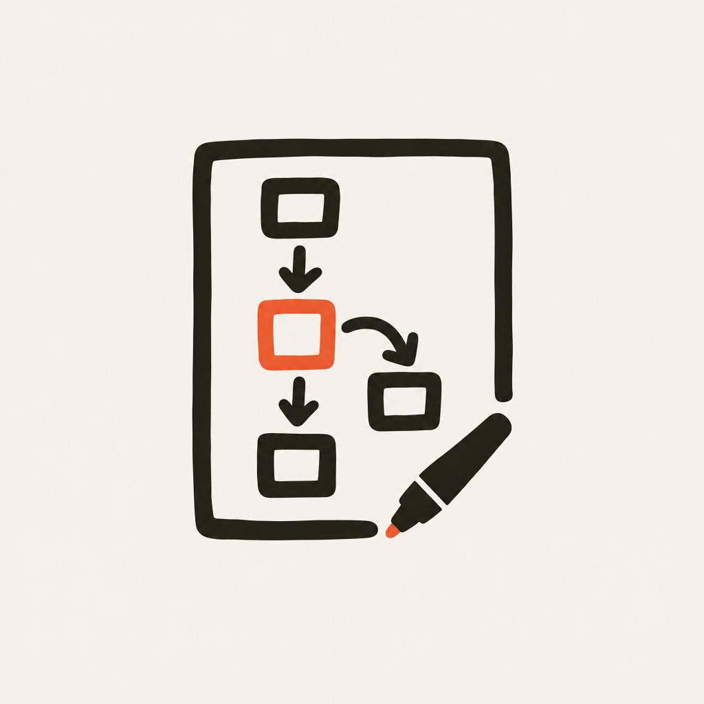

# Logo

`logo.png` — a board, boxes in a flow with one of them lit, and the marker that
drew them. Generated with an image model (Gemini 3 Pro Image, via OpenRouter)
at 1024×1024, flat, three colours: ink `#231e16`, accent `#ef6a4c`, paper
`#f2efe7`.

## There is no icon yet

The logo is nine shapes. That is right for a README, a page header or a social
card, and too much for a favicon: at 48px the boxes become specks and at 16px
it is a smudge.

Six generated reductions lived here and were deleted, because they failed in a
way worth writing down. They were made by **removing** elements from the logo
until something survived 16px, which left a rounded frame with an orange square
in it — legible, and meaningless. It could have been a stop button, or
picture-in-picture, or a colour swatch. Nothing in it said *a board being drawn
on*.

Two lessons:

- Surviving 16px is necessary and not sufficient. A blank square survives 16px.
  A reduction has to keep the idea, not just the pixels.
- The element to keep is the most **distinctive** one, not the most
  **survivable** one. The marker is the only diagonal in the logo and the only
  non-rectangular shape; it is what says "being drawn". A frame and a square
  are what every icon is made of, which is why keeping those said nothing.

When an icon is wanted, the shortest path is to ask the same image model for
it, with `logo.png` attached as a reference: keep the marker and one orange
box, drop everything else, at most three shapes, much larger relative to the
frame. Or accept a slightly soft 16px favicon, which is the normal state of
affairs and costs nothing.
