# The boards that were wrong

Every rendering bug that has been reported keeps its spec in `test/boards/`
and its picture here. The left-hand drawing is frozen at the state the bug was
reported in. The right-hand one is regenerated from the current renderer every
time the suite runs, so it cannot quietly stop matching the code.

This page is generated by `node tools/regressions.js`. Do not edit it by hand.

## tag through label

[#40](https://github.com/pierangeloc/spiega/issues/40) · `test/boards/issue-40-tag-through-label.json`

**What was wrong.** Reported as the `name them` tag on `rel>ops` printing under `What it holds`. Every kind of floating text was placed against its own kind only: tags against tags, callouts against callouts, nothing against node text, note cards or the routed lines. As quoted in the issue this spec no longer prints through a label — #53's wider gutters and wrapped pills had already given both tags room — but both pills were sized into their gutters so that they ran up to their arrowheads, and the gap that caused the report was still there: the same pass put `examples/kalman.json`'s callout across `INNOVATION` when it was asked for `above`, which is why that example had been moved to `right` by hand.

**What changed.** Tags and callouts are now placed in one pass (`src/render/floating.js`) against one obstacle set: every node box with its words, every note card, every arrowhead, every routed line, and each label as soon as it is placed. A word on a word costs far more than a pill across a line, so when nothing is clear the line is what gets crossed. Here both tags move a few pixels back along their own lines, clear of their arrowheads.

| as reported | now |
| --- | --- |
|  | <a href="regressions/issue-40-tag-through-label.svg">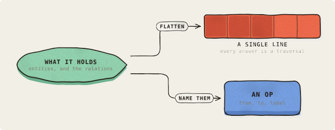</a> |

## a back edge runs through the boxes below its ends

[#49](https://github.com/pierangeloc/spiega/issues/49) · `test/boards/issue-49-back-edge.json`

**What was wrong.** A back edge dropped straight from the bottom of its source to the floor and rose straight into the bottom of its target, and nothing asked what else stood in that column. `b>hub` ran down through Store and Upstream API, and `ext>a` rose through Client Z, so each line entered one box and left another and read as an edge between the wrong two.

**What changed.** An end with a box below it now leaves (or enters) by the side instead and travels down a gutter beside its column, clear of everything in it. Ends with nothing below keep the old route to the floor, and back edges sharing a column's gutter take a lane each.

| as reported | now |
| --- | --- |
| <a href="regressions/issue-49-back-edge-before.svg">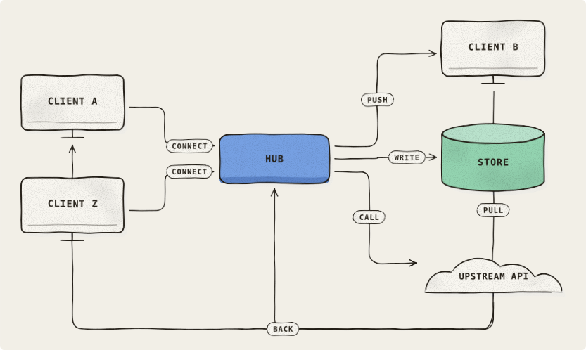</a> | <a href="regressions/issue-49-back-edge.svg">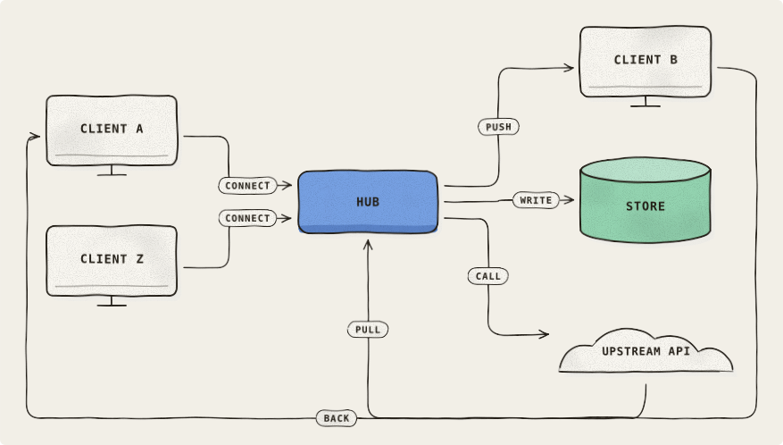</a> |

## fan-out labels

[#52](https://github.com/pierangeloc/spiega/issues/52) · `test/boards/issue-52-fan-out.json`

**What was wrong.** Two things at once. The labels of a fan-out landed on the wrong lines — the board read as if Worker parked into Postgres — and the edge closing the loop left the DLQ through its own name, which rendered as `D|Q`.

**What changed.** The gutter work for #53 gave the fan-out tags their own lines. The loop's anchor and floor now clear the strip a queue keeps its name in.

| as reported | now |
| --- | --- |
| <a href="regressions/issue-52-fan-out-before.svg">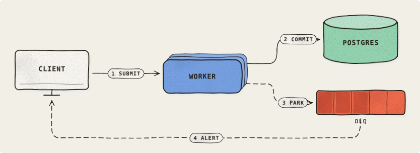</a> | <a href="regressions/issue-52-fan-out.svg">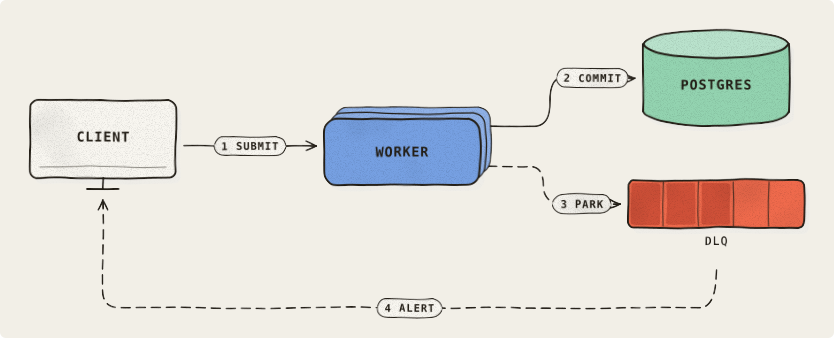</a> |

## crowding repro

[#53](https://github.com/pierangeloc/spiega/issues/53) · `test/boards/issue-53-crowding.json`

**What was wrong.** The gutter between two columns was a constant 132px and a tag was as wide as its text, so a 235px pill was drawn clipped behind the next column's boxes. Node boxes reached 300px because a `sub` that was a sentence never wrapped.

**What changed.** Each boundary is now as wide as the widest tag crossing it, and node text and tag pills both wrap.

| as reported | now |
| --- | --- |
| <a href="regressions/issue-53-crowding-before.svg">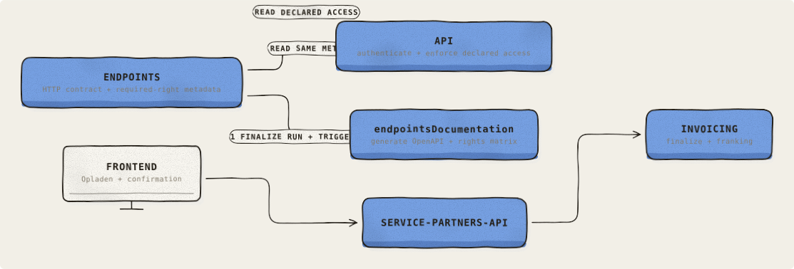</a> | <a href="regressions/issue-53-crowding.svg">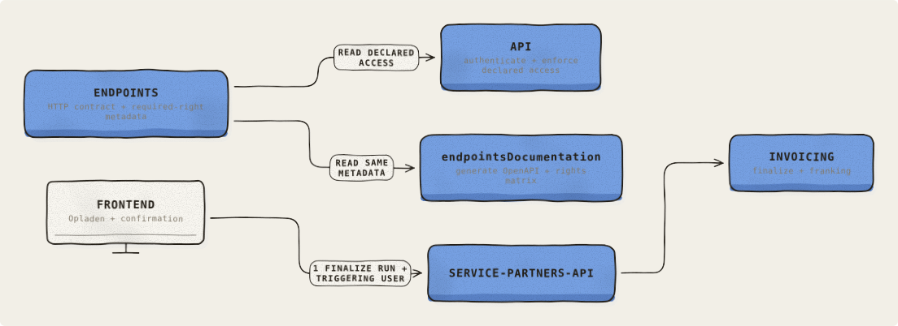</a> |

## Three boundaries that cannot all be true

[#58](https://github.com/pierangeloc/spiega/issues/58) · `test/boards/issue-58-boundary-impossible.json`

**Why there is no before.** Not a reported bug, and there is no frozen `-before` picture because this shape did not exist before #58's fix: it is what the fix does when it cannot make a boundary true. Three overlapping boundaries, `{a,b,c}`, `{c,d}` and `{b,d}`, with `d` outside the first, cannot all be one rectangle in any vertical order, since `{c,d}` needs `b` out of the band between `c` and `d` and `{b,d}` needs `c` out of the band between `b` and `d`. Before the fix each of them was one rectangle that enclosed boxes it never named.

**What it draws, by design.** The boundary that cannot be satisfied is drawn as the fewest rectangles that each enclose only its own members, with its label on each, so the board says less rather than something false. It does not announce that it was split, which is its own open issue.

<a href="regressions/issue-58-boundary-impossible.svg">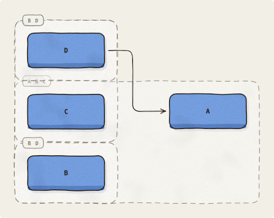</a>

## A boundary over two non-adjacent members

[#58](https://github.com/pierangeloc/spiega/issues/58) · `test/boards/issue-58-boundary-members.json`

**What was wrong.** A boundary was drawn as the bounding box of its members, so when the members were not adjacent in the layout the dashed enclosure also took in every box between them. `NOT A MEMBER` was drawn inside a box labelled `MEMBERS: A AND D ONLY`, and `NOT A MEMBER EITHER` stayed outside only because it happened to fall below the rectangle. #52 part 3 is the same bug, where `b` sits between `a` and `c` in the flow and no column assignment can make them adjacent.

**What changed.** Columns are still the flow's, but a box inside a boundary's columns that is not a member is now stood wholly above or wholly below the enclosure, so the rectangle is true by construction. A boundary that two others make impossible is drawn as the smallest set of true pieces instead of one false rectangle.

| as reported | now |
| --- | --- |
| <a href="regressions/issue-58-boundary-members-before.svg">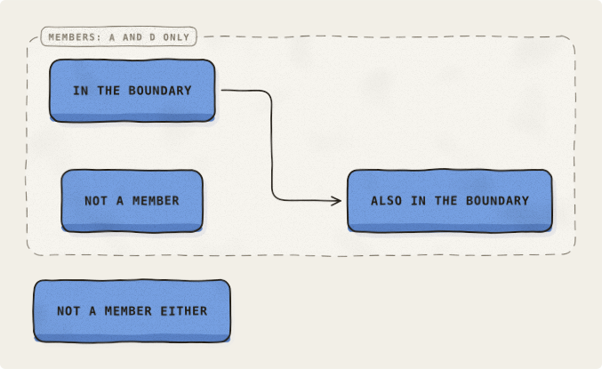</a> | <a href="regressions/issue-58-boundary-members.svg">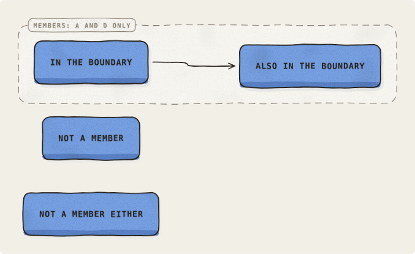</a> |

## backlog: members spread over columns and rows

[#78](https://github.com/pierangeloc/spiega/issues/78) · `test/boards/issue-78-centre-within-slack.json`

**What was wrong.** Follow-up to #58. Once a boundary has to separate a non-member from its members, `separate()` placed boxes by longest path, which packs everything to the top. Columns that no boundary touched lost the centring layout() gives every column and sat at the top edge — `Client` and `Payments` were top-aligned with `Auth` and `Events`, which the boundary really had moved.

**What changed.** A column whose boxes take part in no cross-column constraint is centred against the board again after separation. Members and the boxes a boundary moved stay where the longest path stood them; only the untouched columns come back to the middle, without the boundary re-enclosing a non-member.

| as reported | now |
| --- | --- |
| <a href="regressions/issue-78-centre-within-slack-before.svg">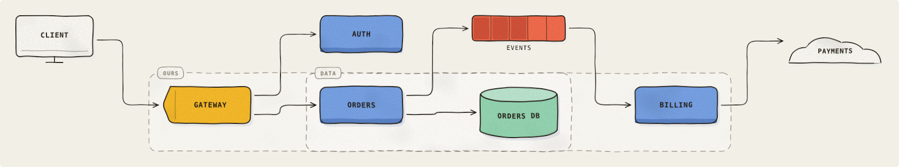</a> | <a href="regressions/issue-78-centre-within-slack.svg">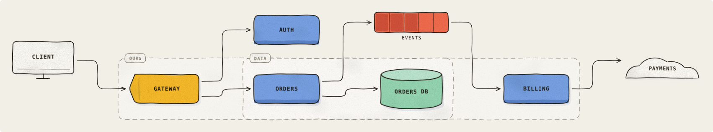</a> |

## edges reach the ink of a blob on all four sides

[#80](https://github.com/pierangeloc/spiega/issues/80) · `test/boards/issue-80-blob-edge-gap.json`

**What was wrong.** `gBlob` drew its outline at `0.46 * w * kx` and `0.4 * h * ky` from the centre (`kx` in 0.93..1.0, `ky` in 0.78..1.0), leaving the ink 10 to 16px inside the left/right of its box and 9 to 12px inside the top/bottom. Edges stop 8px outside the box, so every arrow into or out of a blob ended in empty background.

**What changed.** The ten vertices still wobble independently with `kx` and `ky`, then each half is scaled out to its side of the box (`0.5 * w` and `0.5 * h`), so the outline keeps its uneven hand-drawn mass while reaching the box edges on all four sides.

| as reported | now |
| --- | --- |
| <a href="regressions/issue-80-blob-edge-gap-before.svg">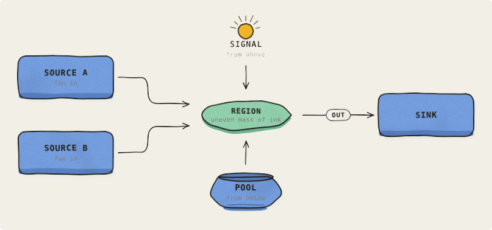</a> | <a href="regressions/issue-80-blob-edge-gap.svg">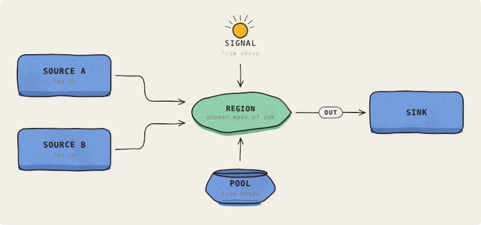</a> |

## one pinned box, three that nothing pins

[#86](https://github.com/pierangeloc/spiega/issues/86) · `test/boards/issue-86-slack-centring.json`

**What was wrong.** Follow-up to #78. The fix that landed (#83) recenters a column only when *every* box in it is free — free meaning no cross-column constraint edge — so a column with one box a boundary pinned and three it never touched is left packed to the top as a whole. `X`, `C` and `D` sit at the top edge with the pinned `B` at y64/312/436 purely because they share a column with it, while `Lone`, alone in its own column, is centred at y301.

**What changed.** Each box is now centred inside its own slack: its earliest position comes from the longest path, and its latest from the same graph run backwards from the board's height. `X`, `C` and `D` come back toward the middle of the tall column's height, `B` stays clear of the `a x` wall below its members, and no boundary re-encloses a non-member.

| as reported | now |
| --- | --- |
| <a href="regressions/issue-86-slack-centring-before.svg">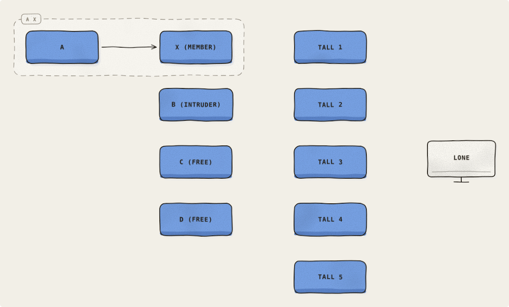</a> | <a href="regressions/issue-86-slack-centring.svg">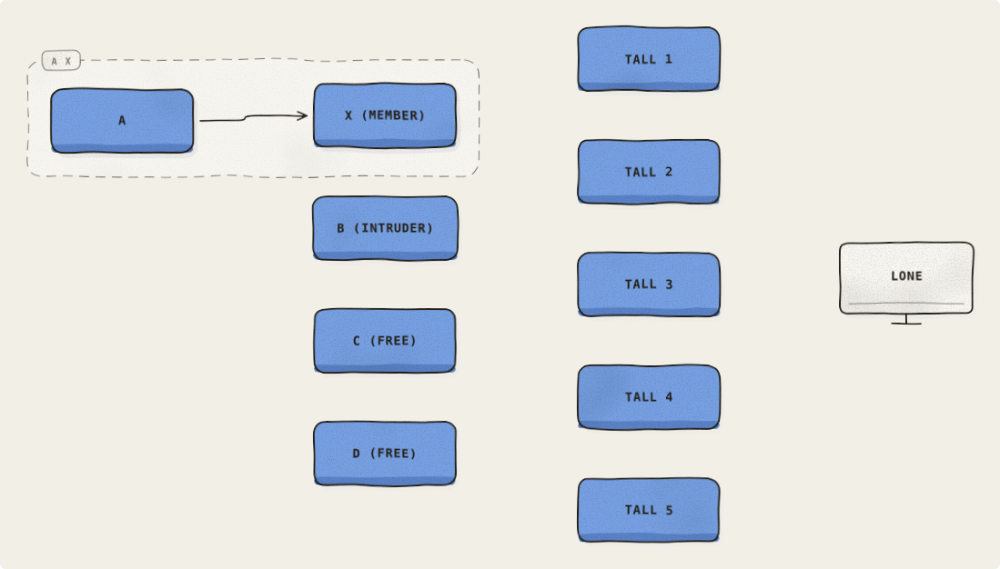</a> |
