# The boards that were wrong

Every rendering bug that has been reported keeps its spec in `test/boards/`
and its picture here. The left-hand drawing is frozen at the state the bug was
reported in. The right-hand one is regenerated from the current renderer every
time the suite runs, so it cannot quietly stop matching the code.

This page is generated by `node tools/regressions.js`. Do not edit it by hand.

## three into one

[#102](https://github.com/pierangeloc/spiega/issues/102) · `test/boards/issue-102-converging-lanes.json`

**What was wrong.** Reported as a label nobody could attribute: `2 BURNS FAST` sat above two lines, and which edge it named had to be worked out from the words. The label was the symptom. Three edges leaving one column for one box turned at the same x — 275.575, 275.842, 275.575 — so their vertical runs lay on top of each other for hundreds of pixels and read as a single line. No placement could fix it: carb's run covered rows 211-285 and fat's covered 87-264.7, so anywhere carb's pill went on its own line it was also on fat's. `test/readable.mjs` saw it as `tag "2 BURNS FAST" sits on fat>energy`, and nothing was told to the agent that drew it.

**What changed.** Edges arriving at one box whose turns coincide and whose runs cover some of the same rows now each get a lane of their own in the gutter, 14px apart and centred on where the turn would have been. The one with least row to change turns first, nearest the column, since its run is the one the others can afford to pass in front of. Fan-out got this in #52 by spreading along the side it leaves; the side could not fix this, because what collided was the turn and not the exit. Here the three turn at 269, 276 and 283, and the label is on its own line.

| as reported | now |
| --- | --- |
| <a href="regressions/issue-102-converging-lanes-before.svg">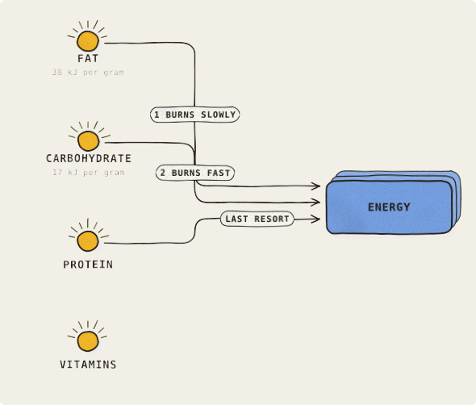</a> | <a href="regressions/issue-102-converging-lanes.svg">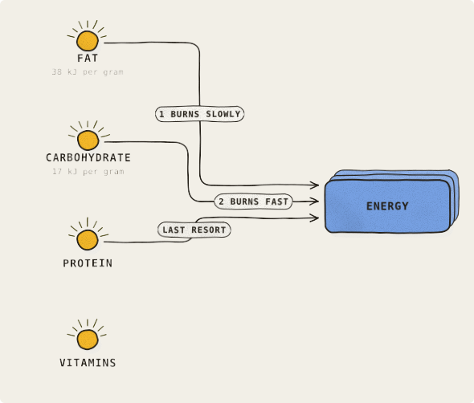</a> |

## tag through label

[#40](https://github.com/pierangeloc/spiega/issues/40) · `test/boards/issue-40-tag-through-label.json`

**What was wrong.** Reported as the `name them` tag on `rel>ops` printing under `What it holds`. Every kind of floating text was placed against its own kind only: tags against tags, callouts against callouts, nothing against node text, note cards or the routed lines. As quoted in the issue this spec no longer prints through a label — #53's wider gutters and wrapped pills had already given both tags room — but both pills were sized into their gutters so that they ran up to their arrowheads, and the gap that caused the report was still there: the same pass put `examples/kalman.json`'s callout across `INNOVATION` when it was asked for `above`, which is why that example had been moved to `right` by hand.

**What changed.** Tags and callouts are now placed in one pass (`src/render/floating.js`) against one obstacle set: every node box with its words, every note card, every arrowhead, every routed line, and each label as soon as it is placed. A word on a word costs far more than a pill across a line, so when nothing is clear the line is what gets crossed. Here both tags move a few pixels back along their own lines, clear of their arrowheads.

| as reported | now |
| --- | --- |
|  |  |

## a back edge runs through the boxes below its ends

[#49](https://github.com/pierangeloc/spiega/issues/49) · `test/boards/issue-49-back-edge.json`

**What was wrong.** A back edge dropped straight from the bottom of its source to the floor and rose straight into the bottom of its target, and nothing asked what else stood in that column. `b>hub` ran down through Store and Upstream API, and `ext>a` rose through Client Z, so each line entered one box and left another and read as an edge between the wrong two.

**What changed.** An end with a box below it now leaves (or enters) by the side instead and travels down a gutter beside its column, clear of everything in it. Ends with nothing below keep the old route to the floor, and back edges sharing a column's gutter take a lane each.

| as reported | now |
| --- | --- |
|  |  |

## fan-out labels

[#52](https://github.com/pierangeloc/spiega/issues/52) · `test/boards/issue-52-fan-out.json`

**What was wrong.** Two things at once. The labels of a fan-out landed on the wrong lines — the board read as if Worker parked into Postgres — and the edge closing the loop left the DLQ through its own name, which rendered as `D|Q`.

**What changed.** The gutter work for #53 gave the fan-out tags their own lines. The loop's anchor and floor now clear the strip a queue keeps its name in.

| as reported | now |
| --- | --- |
|  |  |

## crowding repro

[#53](https://github.com/pierangeloc/spiega/issues/53) · `test/boards/issue-53-crowding.json`

**What was wrong.** The gutter between two columns was a constant 132px and a tag was as wide as its text, so a 235px pill was drawn clipped behind the next column's boxes. Node boxes reached 300px because a `sub` that was a sentence never wrapped.

**What changed.** Each boundary is now as wide as the widest tag crossing it, and node text and tag pills both wrap.

| as reported | now |
| --- | --- |
|  |  |

## verbranding in de cel

[#54](https://github.com/pierangeloc/spiega/issues/54) · `test/boards/issue-54-phase-tiers.json`

**Why there is no before.** Not a bug and there is no frozen `-before` picture, because this shape could not be drawn before. The board had exactly two states for anything — lit, or dimmed to half — so a phase of several steps had no way to say which part of the picture it was about. #54 worried that a third tier would read as a board that was slightly broken rather than as a phase.

**What it draws, by design.** It is not a third tier of grey. There are two things being said and they use different means: opacity says whether a thing is in the phase being explained, and the accent says which single hop is happening now. So the rest of the phase is drawn exactly as it is on a board with nothing lit at all, and what moves is everything around it. The picture is step 3 of 5, in a phase with step 4: BLOED and CEL carry the step with its halo and its orange arrow, CO2 and the arrow into it are the rest of the phase at full strength, and VOEDSEL, DARM and LONG recede.

<a href="regressions/issue-54-phase-tiers.svg">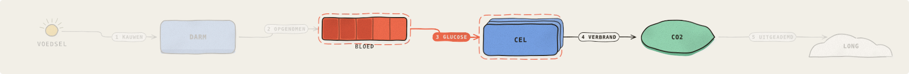</a>

## seven rules, two budgets

[#56](https://github.com/pierangeloc/spiega/issues/56) · `test/boards/issue-56-arrow-under-box.json`

**Why there is no before.** Not a rendering bug, and there is no frozen `-before` picture because nothing here regressed: this is the board the audit was built to be able to describe. It is the synthetic stand-in for the board in #48 — one store fanning out to seven rules that reconverge on two budgets — and after #40, #48 and #53 nothing on it prints over anything, which is why `board_draw` could answer `14 boxes, 17 lines` and be telling the truth. It is still wrong in a way no check caught: `r7>ext` leaves rule 7, turns up, and runs underneath the risk budget box and underneath the note, so the line is visible above and below each of them and absent in between. A reader follows it into one box and out of another.

**What it draws, by design.** Nothing moved. What changed is that the board now says so: `src/render/audit.js` measures the drawing and `POST /op` answers `2 arrows cross a box that is not an end of it: r7>ext through risk, r7>ext through n2` to the agent that drew it. The picture is committed for the same reason as the others — it is what a later change to edge routing will be read against, and the day this board draws with no buried arrow is the day the audit's line goes quiet on it.

<a href="regressions/issue-56-arrow-under-box.svg">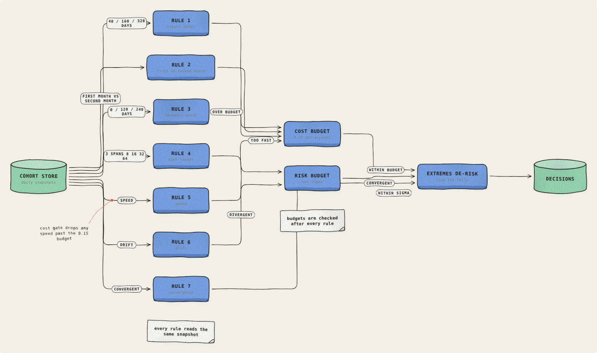</a>

## Three boundaries that cannot all be true

[#58](https://github.com/pierangeloc/spiega/issues/58) · `test/boards/issue-58-boundary-impossible.json`

**Why there is no before.** Not a reported bug, and there is no frozen `-before` picture because this shape did not exist before #58's fix: it is what the fix does when it cannot make a boundary true. Three overlapping boundaries, `{a,b,c}`, `{c,d}` and `{b,d}`, with `d` outside the first, cannot all be one rectangle in any vertical order, since `{c,d}` needs `b` out of the band between `c` and `d` and `{b,d}` needs `c` out of the band between `b` and `d`. Before the fix each of them was one rectangle that enclosed boxes it never named.

**What it draws, by design.** The boundary that cannot be satisfied is drawn as the fewest rectangles that each enclose only its own members, with its label on each, so the board says less rather than something false. Each piece says which piece it is (#77): see `issue-77-split-boundary-unmarked`.

## A boundary over two non-adjacent members

[#58](https://github.com/pierangeloc/spiega/issues/58) · `test/boards/issue-58-boundary-members.json`

**What was wrong.** A boundary was drawn as the bounding box of its members, so when the members were not adjacent in the layout the dashed enclosure also took in every box between them. `NOT A MEMBER` was drawn inside a box labelled `MEMBERS: A AND D ONLY`, and `NOT A MEMBER EITHER` stayed outside only because it happened to fall below the rectangle. #52 part 3 is the same bug, where `b` sits between `a` and `c` in the flow and no column assignment can make them adjacent.

**What changed.** Columns are still the flow's, but a box inside a boundary's columns that is not a member is now stood wholly above or wholly below the enclosure, so the rectangle is true by construction. A boundary that two others make impossible is drawn as the smallest set of true pieces instead of one false rectangle.

| as reported | now |
| --- | --- |
|  |  |

## A boundary drawn as two pieces, and nothing says so

[#77](https://github.com/pierangeloc/spiega/issues/77) · `test/boards/issue-77-split-boundary-unmarked.json`

**What was wrong.** Follow-up to #58. A boundary that cannot be one true rectangle is drawn as several, with its label on each, and that is true about membership but says something else: two dashed rectangles under one name read as two boundaries that happen to share a name, not as one boundary that could not be drawn as one. Here `{b,d}` is drawn as a rectangle round `D` and another round `B`, and both cards read `B D`; nothing on the board says they are one. This is the spec of `issue-58-boundary-impossible`, kept under its own name because it is the picture this issue is read against. The overdrawn tab the issue also mentions was #87.

**What changed.** Each card of a split boundary says which piece it is, `B D (1/2)` and `B D (2/2)`, numbered the way the board is read, top to bottom and then left to right. A link between the pieces was not drawn: the pieces are apart because something that is not a member stands between them, so a line would have to run through or around the very boxes the split keeps out, and would read as an edge. A boundary that is one rectangle keeps its name exactly as written.

| as reported | now |
| --- | --- |
|  | <a href="regressions/issue-77-split-boundary-unmarked.svg">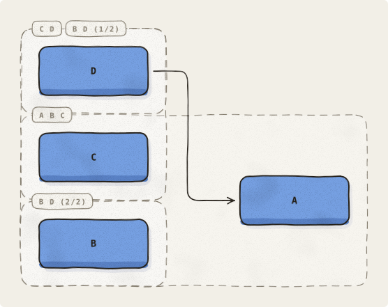</a> |

## backlog: members spread over columns and rows

[#78](https://github.com/pierangeloc/spiega/issues/78) · `test/boards/issue-78-centre-within-slack.json`

**What was wrong.** Follow-up to #58. Once a boundary has to separate a non-member from its members, `separate()` placed boxes by longest path, which packs everything to the top. Columns that no boundary touched lost the centring layout() gives every column and sat at the top edge — `Client` and `Payments` were top-aligned with `Auth` and `Events`, which the boundary really had moved.

**What changed.** A column whose boxes take part in no cross-column constraint is centred against the board again after separation. Members and the boxes a boundary moved stay where the longest path stood them; only the untouched columns come back to the middle, without the boundary re-enclosing a non-member.

| as reported | now |
| --- | --- |
|  |  |

## edges reach the ink of a blob on all four sides

[#80](https://github.com/pierangeloc/spiega/issues/80) · `test/boards/issue-80-blob-edge-gap.json`

**What was wrong.** `gBlob` drew its outline at `0.46 * w * kx` and `0.4 * h * ky` from the centre (`kx` in 0.93..1.0, `ky` in 0.78..1.0), leaving the ink 10 to 16px inside the left/right of its box and 9 to 12px inside the top/bottom. Edges stop 8px outside the box, so every arrow into or out of a blob ended in empty background.

**What changed.** The ten vertices still wobble independently with `kx` and `ky`, then each half is scaled out to its side of the box (`0.5 * w` and `0.5 * h`), so the outline keeps its uneven hand-drawn mass while reaching the box edges on all four sides.

| as reported | now |
| --- | --- |
|  |  |

## fanned edges reach the ink of a convex glyph

[#85](https://github.com/pierangeloc/spiega/issues/85) · `test/boards/issue-85-convex-glyph-arrival.json`

**What was wrong.** Follow-up to #80. Scaling a blob's vertices out to the box made a line at a side's midpoint meet the ink, but a convex outline curves away from its box everywhere else. A fanned arrival — `t = ±1`, `0.26 * h` off centre — still stopped at the box, ~20px short of the ink on UPDATE and further on a vessel, a particle or a cloud, in proportion to how far that ink sits inside its box.

**What changed.** A glyph now says how far its ink is inside the box at a station along a side, and the box carries that answer because an edge only ever sees a box. The line stops GAP short of the ink instead of the box. A rectangle answers 0, so a board without one of these glyphs does not move. The hand's wobble is untouched: the inset is taken from the outline, not from the waver on top of it.

| as reported | now |
| --- | --- |
| <a href="regressions/issue-85-convex-glyph-arrival-before.svg">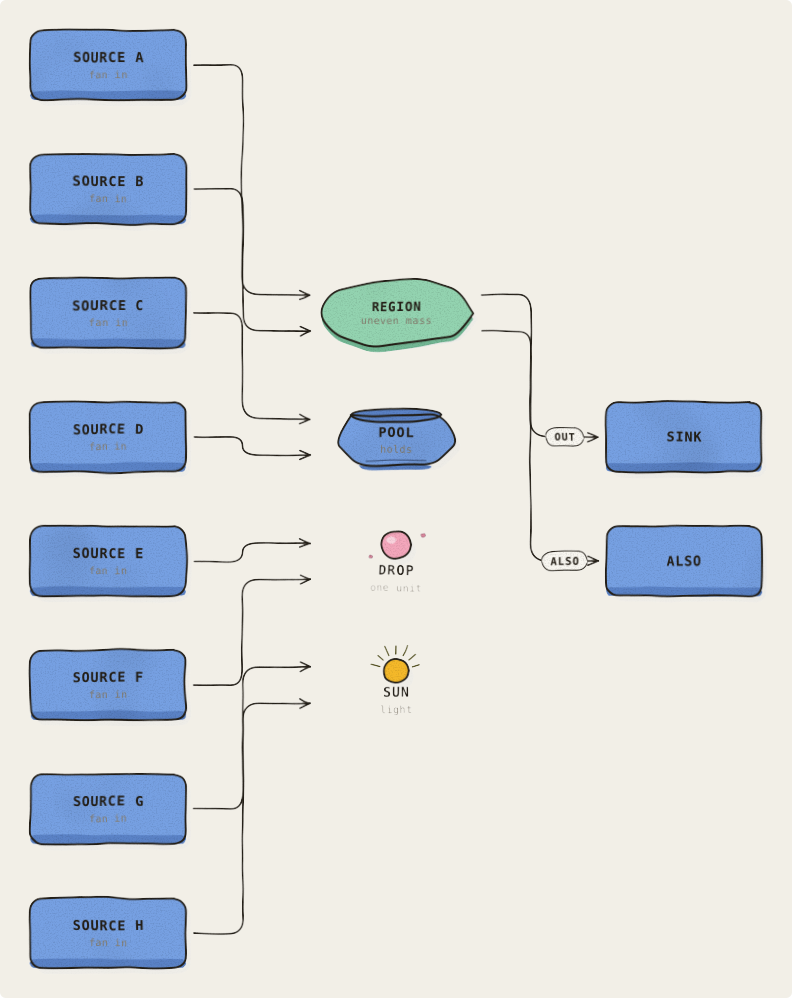</a> | <a href="regressions/issue-85-convex-glyph-arrival.svg">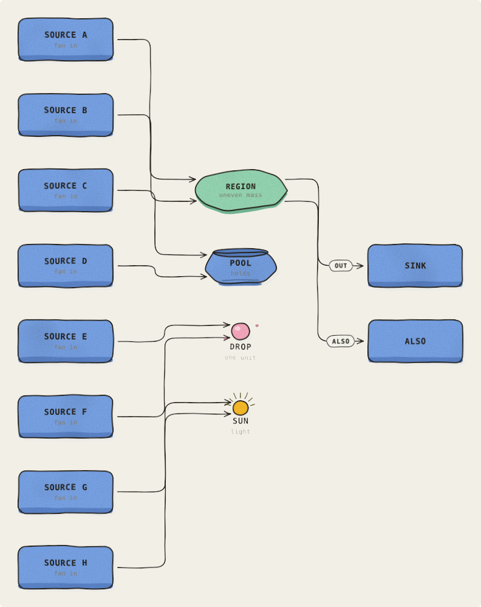</a> |

## one pinned box, three that nothing pins

[#86](https://github.com/pierangeloc/spiega/issues/86) · `test/boards/issue-86-slack-centring.json`

**What was wrong.** Follow-up to #78. The fix that landed (#83) recenters a column only when *every* box in it is free — free meaning no cross-column constraint edge — so a column with one box a boundary pinned and three it never touched is left packed to the top as a whole. `X`, `C` and `D` sit at the top edge with the pinned `B` at y64/312/436 purely because they share a column with it, while `Lone`, alone in its own column, is centred at y301.

**What changed.** Each box is now centred inside its own slack: its earliest position comes from the longest path, and its latest from the same graph run backwards from the board's height. `X`, `C` and `D` come back toward the middle of the tall column's height, `B` stays clear of the `a x` wall below its members, and no boundary re-encloses a non-member.

| as reported | now |
| --- | --- |
|  |  |

## Three pairs of three boxes

[#87](https://github.com/pierangeloc/spiega/issues/87) · `test/boards/issue-87-tabs-collide.json`

**What was wrong.** A boundary's name rides a card on its wall, at a fixed offset from the corner, and nothing resolved it against anything. Two enclosures whose walls start at the same height put their cards in the same place and one was painted over the other: the board read `b c`, `a c`, `b c` and `a b` was nowhere on it. Not mislabelled — absent, and nothing on the board said which boundary had gone missing. Three boxes and three boundaries is the floor for it: with no edges every box is in one column, and three pairwise-intersecting sets of members cannot all be made contiguous in one vertical order, so one of the boundaries is drawn as two pieces and the first piece wants the same corner as the first boundary.

**What changed.** The card is placed in the same pass as everything else that floats (`src/render/floating.js`), against the same obstacle set, and it slides along the top of its own wall until it is clear of the cards already placed. It is placed first, because the name of an enclosure is structure and a label riding an edge gives way to it rather than the other way round. The cards are drawn after every wall instead of with the wall they belong to, so a dashed wall cannot strike a name through it.

| as reported | now |
| --- | --- |
| <a href="regressions/issue-87-tabs-collide-before.svg">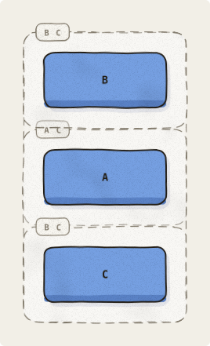</a> | <a href="regressions/issue-87-tabs-collide.svg">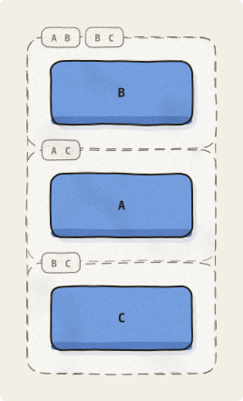</a> |

## which Kafka event field maps to which column of the CSV export

[#93](https://github.com/pierangeloc/spiega/issues/93) · `test/boards/issue-93-field-mapping.json`

**Why there is no before.** Not a reported rendering bug, and there is no frozen `-before` picture because this board could not be drawn honestly at all before the fix: there was no shape for a named value. A board asked to show which Kafka event fields map to which columns of a CSV export drew every field on both sides as a `datastore` cylinder and the source fields as `queue` slot-rows, so the picture asserted `durable storage` and `a queue` about a list of field names — fourteen false claims. The vocabulary had nothing that fitted: the software kinds all claim that the thing is a piece of infrastructure, and the four neutral ones (`blob` `vessel` `particle` `source`) are for figures that are not about software at all. Told only to use the right shape, an agent moves to `service`, which claims the field is a component and colours every field service-blue on a board that also has real services.

**What it draws, by design.** A `field` kind: a card with one corner notched, sharp-cornered so it cannot be read as a `service`, neutral about infrastructure so it cannot be read as a `datastore`. The notch is on the side the value runs — right where a field gives a value, left where it only receives one — so the two sides of a mapping mirror each other across the gutter and the reader tells source from target by the shape and not by a colour. The board is the reported case: a column of source fields, a column of target fields, `1:1` tags between them, and a boundary round the export side.

<a href="regressions/issue-93-field-mapping.svg">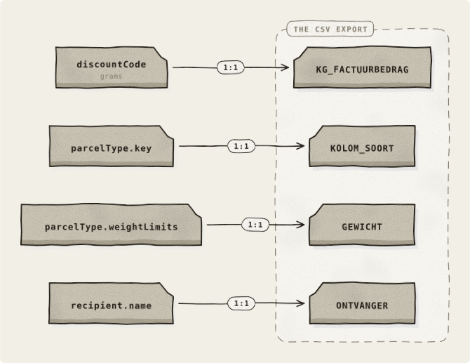</a>

## Three branches declared out of flow order

[#96](https://github.com/pierangeloc/spiega/issues/96) · `test/boards/issue-96-interleaved-branches.json`

**What was wrong.** The companion reproduction for #96's ordering seam: three branches are declared A/B/C in the first rank, C/A/B in the second and B/C/A in the third. Incremental nextRow placement follows that declaration order, making four between-rank edge crossings and pulling children away from their own parents. The before picture was rendered and frozen before this spec opted into settle.

**What changed.** At the final settle moment dagre orders the three ranks consistently. Each branch becomes a straight horizontal chain, and all four between-rank crossings disappear. Only ranks and in-rank ordering are used: the renderer, gutters and ink are unchanged. The test asserts four crossings before and zero after; the committed pair shows exactly that change.

| as reported | now |
| --- | --- |
| <a href="regressions/issue-96-interleaved-branches-before.svg">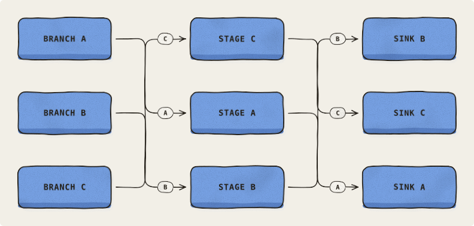</a> | <a href="regressions/issue-96-interleaved-branches.svg">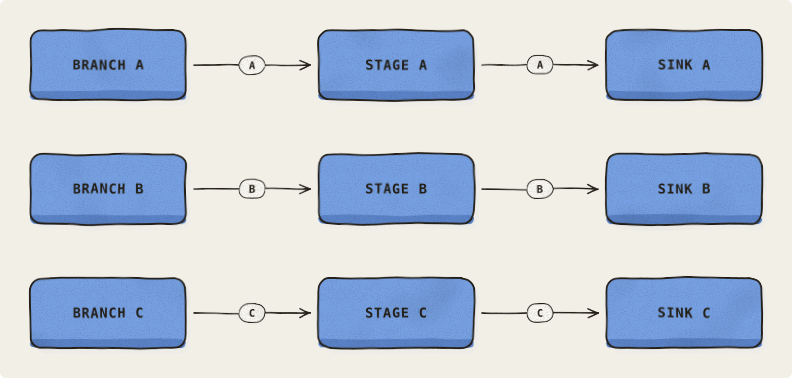</a> |

## PR #81 — notification and command walkthrough

[#96](https://github.com/pierangeloc/spiega/issues/96) · `test/boards/issue-96-long-span.json`

**What was wrong.** The PR #81 walkthrough is a horizontal ribbon: insertion-order placement leaves every column's first box on row zero, and notif>log spans five columns because consumer also writes the log. The frozen before picture is the original incremental layout, before any settle implementation existed.

**What changed.** Settle keeps dagre's intermediate dummy slots as frozen edge waypoints. Each waypoint reserves a row in its column, and notif>log follows those lanes below Command, CNS, Result and Consumer rather than cutting across their boxes or labels. The board remains wide because the flow still has eight columns; the long edge no longer shares their ribbon. CNS and the notifications table keep their reported names; the original before artifact stays frozen with its earlier generic labels. The companion issue-96-interleaved-branches board still demonstrates four crossings becoming zero.

| as reported | now |
| --- | --- |
| <a href="regressions/issue-96-long-span-before.svg">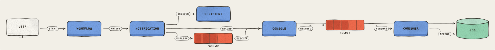</a> | <a href="regressions/issue-96-long-span.svg">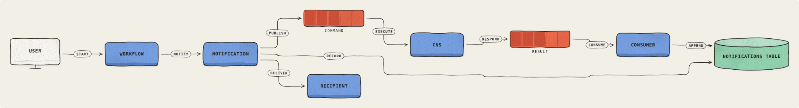</a> |
