# The shapes

What each thing an agent can draw actually looks like. Every picture on this
page is generated by `node tools/shapes.js` from the same renderer the live
board uses, so it cannot drift from what you will see: change a glyph, run it
again, and the page is up to date.

[vocabulary.md](vocabulary.md) is the reference — every op and field. This is
the picture of it.

## Node kinds

Eight kinds for software, `note` and `formula` for writing and mathematics, and
four that carry no infrastructure meaning. An unknown kind is drawn as a
`service`, so a guess is never an error.

| | kind | use it for |
|---|---|---|
|  | `client` | a browser, an app, whoever is calling |
| 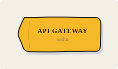 | `gateway` | an API gateway, a load balancer, an ingress |
| 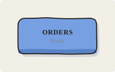 | `service` | an ordinary service or module |
| 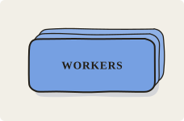 | `compute` | a replica set, a worker pool — `replicas` sets how many |
| 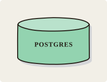 | `datastore` | a database, a bucket, anything durable |
| 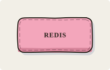 | `cache` | a cache, a read replica, a copy of truth |
| 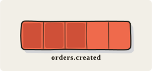 | `queue` | a topic, a queue, a stream — `depth` fills slots |
| 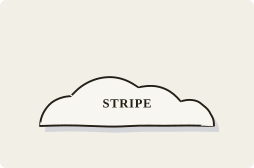 | `external` | a third party, something you do not own |
| 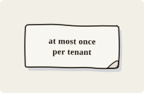 | `note` | a keyword, a caveat, a number, in the margin |
| 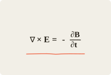 | `formula` | an equation that *is* the explanation |
| 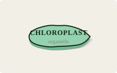 | `blob` | a body, a region, a mass with no fixed form |
| 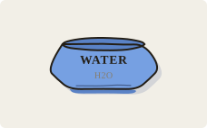 | `vessel` | a container: a cell, a tank, a reservoir |
| 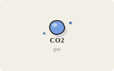 | `particle` | a molecule, a drop, one unit of a substance |
| 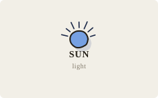 | `source` | the sun, a spring, wherever something comes from |

The last four are the neutral ones. A figure of photosynthesis can say what it
means without borrowing software's nouns: `source` for the sun, `vessel` for
water, `particle` for a gas, `blob` for the organism.

```json
{"op":"node","id":"sun","kind":"source","label":"Sun"}
{"op":"node","id":"water","kind":"vessel","label":"Water","sub":"H2O"}
{"op":"node","id":"co2","kind":"particle","label":"CO2"}
{"op":"node","id":"leaf","kind":"blob","label":"Leaf"}
```

Colour is assigned by kind, not chosen: a datastore is always mint, a queue
always tomato. That is what makes two boards of the same system look like the
same system.

```json
{"op":"node","id":"orders","kind":"service","label":"Orders","sub":"Kotlin"}
{"op":"node","id":"workers","kind":"compute","label":"Workers","replicas":3}
{"op":"node","kind":"queue","label":"orders.created","depth":3}
```

## Lines between them

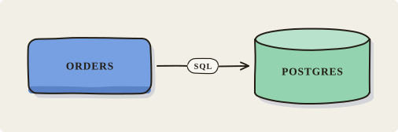

```json
{"op":"edge","from":"orders","to":"postgres","label":"SQL"}
```

An `async` edge is dashed, for anything the caller does not wait on:

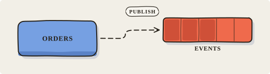

```json
{"op":"edge","from":"orders","to":"events","label":"publish","async":true}
```

An edge pointing back at something upstream is a loop, and is routed under the
row rather than back through it — feedback, retries, a control loop:

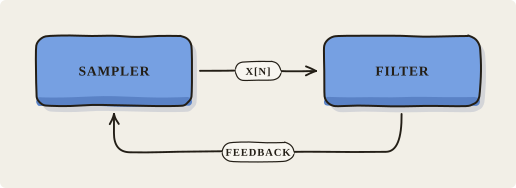

```json
{"op":"edge","from":"sampler","to":"filter","label":"x[n]"}
{"op":"edge","from":"filter","to":"sampler","label":"feedback"}
```

## Grouping and annotating

A `boundary` draws a dashed enclosure around named members — a VPC, a process,
a bounded context, a trust boundary:

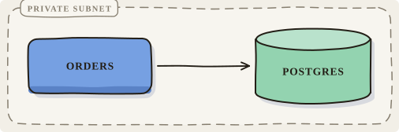

```json
{"op":"boundary","id":"vpc","label":"private subnet","members":["orders","postgres"]}
```

A `callout` says something *about* a thing without crowding it. `at` is a node
id or an edge written `from>to`; `side` is `below`, `above`, `left`, `right`:

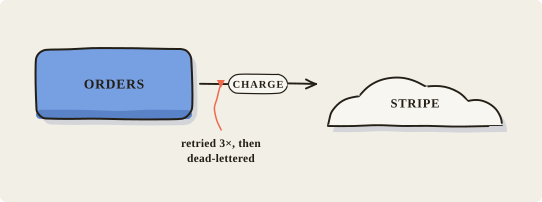

```json
{"op":"callout","at":"orders>stripe","label":"retried 3×, then dead-lettered"}
```

## One step of the flow

A step lights what it is about and dims everything else, so a board of twelve
boxes can be read one hop at a time. The edge carries its number.

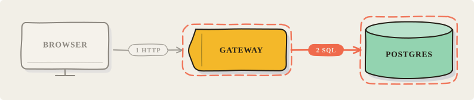

```json
{"op":"flow","steps":[{"edge":"browser>gateway"},{"edge":"gateway>postgres"}]}
{"op":"focus","step":1}
```

`lights` adds nodes that are part of the step without being either end of its
edge. A `note` never dims: the one sentence explaining why a step matters
should not fade out exactly when that step is being explained.

---

Nothing here takes coordinates. Columns come from the edges, rows from what
would otherwise collide, and the canvas grows to fit whatever falls outside —
see [*Where things go*](vocabulary.md#where-things-go) for why that is not
negotiable.
